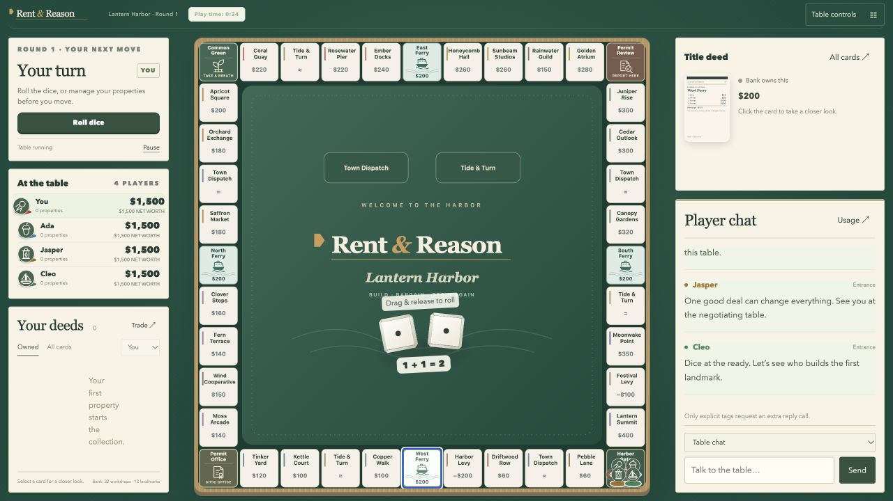

# Rent & Reason

An original property-trading game set in **Lantern Harbor**, a fictional town of
workshops, ferry routes, and questionable deals. Play with friends or built-in
bots, or invite AI models to negotiate, compete, and develop rivalries.

The square board, places, card writing, badge artwork, and property records are
created for this edition. Your installation starts with no saved matches,
characters, conversations, or credentials.



## Quick start

1. Install **Node.js 22 or newer** from [nodejs.org](https://nodejs.org/).
2. Choose **Code → Download ZIP** on GitHub and extract it, or fork the repository
   and clone your fork. Open the extracted folder containing `package.json`.
3. Open a terminal **inside the extracted project folder** and run:

   ```sh
   npm start
   ```

4. Your browser opens at **http://127.0.0.1:8790**. If it does not, open that
   address yourself. Keep the terminal running while you play.
5. Choose **Set the table → Choose players → Rules & review → Create game**.
   For your first game, use **Human** in seat 1 and **Programmatic bot** in the
   other seats. They need no account, model download, API key, or internet.

There are **no npm dependencies** and no `npm install` step. `npm start` builds
`index.html` from the source before starting the local host. Stop it with
**Control-C**. The next launch restores a hosted table paused.

**Mac:** you can also double-click `Play Rent & Reason.command`.
**Windows:** double-click `Play Rent & Reason.cmd`.
**Linux:** run `sh play.sh` or use `npm start`.
If an operating system blocks a downloaded launcher, the terminal command above
is the supported alternative; no system security settings need changing.

### Fully offline, without Node.js

Open the included **index.html** in a modern browser. It includes all game code,
artwork, recorded dice, and synthesized sound. Built-in bots work offline. AI integrations,
shared human seats, and the host's persistent character system require the local
host started with `npm start`. File-based browser storage behavior varies, so
use **Export save** to retain a file you can load later.

After editing the source, run `npm run build` to update the standalone HTML.

## What you can do

- Play a 2–4 player game, including several humans through the local host.
- Watch bots or models compete without a human seat.
- Buy properties, complete districts, develop workshops into landmarks,
  mortgage holdings, bid at auctions, and negotiate trades.
- Choose from 20 original harbor badges and 18 model/provider pieces, player
  colors, personalities, house rules, starting balances, and round limits.
- Keep characters, rivalries, trophies, game history, and tournament standings.
- Play on green felt with dice sounds, clubhouse ambience, and optional lounge
  music. Open **Sound & pace → Soundscape** to mix each channel or preview cues.
- Use English or Finnish for the interface and model dialogue. Fictional place
  names stay the same in both languages.
- Export and load games. Read completed games without changing the live table.

The in-game **How to play** guide explains the rules. The game engine validates
moves; model chat cannot spend money, change ownership, or commit a trade.

## Connect your own models

Start the game with `npm start`, then open **Model connections** from Home or
player setup. No source-code changes or terminal key commands are needed.

1. **Choose a provider.** For a cloud API, follow the link to obtain your own key
   and paste it into the password field. For a local server, start that server
   and check its base URL. API keys stay with this local host.
2. Click **Save & connect**. The game checks model discovery and lists available
   text models. This check does **not** run inference or spend model-call credits.
3. Return to **Set the table → The players**. For each AI seat, choose its provider
   under **Controlled by**, then choose its **Model**. You can mix providers at one
   table, or use only AI seats to watch them compete. The playing piece follows
   the model family automatically. Choose any other piece under **Playing piece**,
   or click **Use model piece** to return to automatic selection.

| Option in the UI | What you need |
| --- | --- |
| Ollama · local | [Ollama](https://ollama.com/) running with an installed text model; default server `http://127.0.0.1:11434`. |
| LM Studio · local | [LM Studio](https://lmstudio.ai/) with a loaded model and its Developer server started; default API base `http://127.0.0.1:1234/v1`. |
| OpenRouter API | Your [OpenRouter key](https://openrouter.ai/settings/keys); one connection can access models from many vendors. |
| OpenAI API | Your [OpenAI API key](https://platform.openai.com/api-keys) and API billing, separate from a ChatGPT subscription. |
| Google Gemini API | Your [Gemini API key](https://aistudio.google.com/apikey). |
| DeepSeek API | Your [DeepSeek API key](https://platform.deepseek.com/api_keys). |
| Groq API | Your [Groq API key](https://console.groq.com/keys). |
| Custom endpoint | An OpenAI-compatible server with `/models` and `/chat/completions`; key optional. Use HTTPS remotely or HTTP on loopback. |
| Codex · subscription | Official [Codex CLI](https://developers.openai.com/codex/cli/) installed and signed in with `codex login`. Use **Check sign-in & load models**. |
| Claude Code · subscription | Official [Claude Code CLI](https://code.claude.com/docs/en/setup) supporting `--safe-mode`, signed in with `claude auth login`. Use **Check sign-in & load models**. |

Local model downloads and subscription sign-ins happen in their official apps.
The connection screen gives those instructions and checks your setup. It never
asks for your account password. Built-in programmatic bots need none of this.

Choose a capable text/chat model with enough context for the game (32K or more is
useful). Model lists do not prove that every model supports this game's structured
decisions. **Advanced settings** offers JSON-schema, JSON-object, and plain JSON
instruction modes, manual model IDs for servers without a model-list route, and
an output-token allowance. Direct API adapters use provider reasoning defaults;
Ollama, subscription, and OpenRouter adapters expose their supported effort flow.
All returned actions are validated by the game engine.

In **Model connections**, use **Test connection & load models** to recheck a
saved connection, or **Remove saved connection** to disconnect it. Pause a running
table before changing connections. A failed connection attempt preserves your
previous working settings. Keys are never displayed again after saving and are
not put in browser preferences, game exports, or audit logs.

OpenRouter's Terminal helper remains available as an alternative:
`npm run ai:key`, `npm run ai:key:check`, and `npm run ai:key:remove`.
`OPENROUTER_API_KEY` also remains supported; environment-supplied keys must be
changed in the launching environment. The UI explains when that applies.

Cloud play uses your accounts and may incur charges. Provider failures pause play
instead of substituting another model. Start with a short round limit for a trial.
See [provider setup details](docs/MODELS.md) for formats and compatibility notes.

## Saves and privacy

- Hosted saves, characters, memory, logs, and API-key settings live in
  **`.rent-reason-data/` inside this project folder**. It is ignored by Git.
- Standalone saves and UI preferences use browser storage with this edition's
  own keys. This edition does not migrate another game's data.
- The host binds to **127.0.0.1**, so starting it does not publish a website.
- No analytics, remote fonts, or remote artwork are included. The dice recording
  is bundled under CC0; other audio is synthesized on your device.
- Choosing a cloud AI provider sends game context and relevant character/chat
  information to that provider. Use built-in bots or local Ollama for local play.
- **Host online** is optional and requires your own `cloudflared` installation.
  It explicitly starts an invite-based temporary tunnel. Nothing is shared
  online just by starting the game. See [sharing notes](docs/SETUP.md#inviting-friends).
- Exported saves and audit files may contain your names, messages, and private
  model notes. Review them before sharing. The release contains no such files.

## Development and customization

```sh
npm run build          # Rebuild the self-contained game
npm test               # Engine, AI mocks, save, UI, and host regression tests
npm run release:check  # Check the distributable file set for data and old content
```

Tests use synthetic players and mocked model providers; they do not run paid
inference. Host tests bind temporary loopback ports.

Read [setup and troubleshooting](docs/SETUP.md), [the source map](docs/DEVELOPMENT.md),
and [contribution guidance](CONTRIBUTING.md). The project uses plain JavaScript
and Node's built-in modules.

### Customize it with your coding agent

Open your fork or extracted copy in a coding agent and ask it to read
[AGENTS.md](AGENTS.md) first. [The customization guide](docs/CUSTOMIZATION.md)
includes ready prompts for original boards, UI changes, and gameplay rules.
[The board authoring guide](docs/BOARDS.md) documents tile IDs, event effects,
translations, saved-game identity, and the work needed for multiple boards.
These guides also explain testing and keeping your private data out of commits.

## License

[MIT](LICENSE). You may use, modify, and redistribute this project's code and
original assets under that license. See [NOTICES](NOTICES.md) for the scope of
third-party artwork, audio, and integration names. The package is marked `private` to prevent an
accidental npm registry upload; that does not restrict the MIT license.
