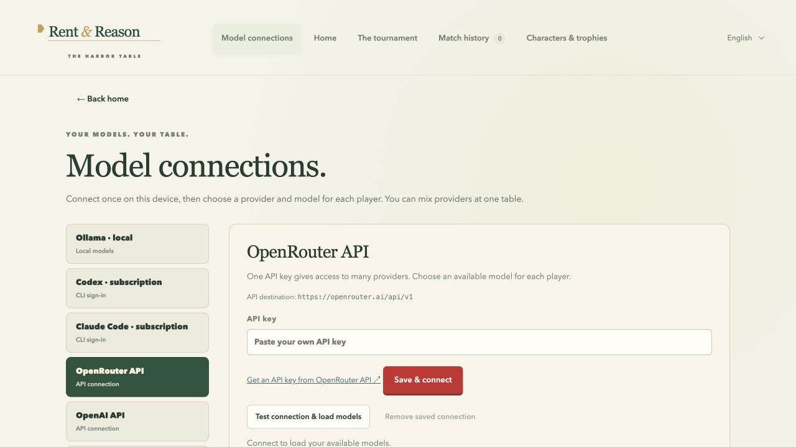

# Connecting models

All model setup is available under **Home → Model connections**. Start the Node
host with `npm start`; the file-only offline game cannot manage backend keys.
The screen pauses an active hosted table before changing connections. Setup
drafts and your current match are preserved while you visit the screen.

## Local models

**Ollama:** start the Ollama app and install a text model. Keep the default
`http://127.0.0.1:11434` URL unless you changed its loopback port. Choose **Save &
connect**. Ollama's adapter uses structured JSON and a 32K context allocation.

**LM Studio:** load a text model, open the Developer tab and start its server.
Use `http://127.0.0.1:1234/v1` (or your chosen loopback port). Leave the key blank
unless you enabled server authentication. Configure sufficient context in LM
Studio; the client does not download or resize your model. JSON output support
varies by model and server.

**Other local servers:** choose **Custom endpoint**. Enter the OpenAI-compatible
base URL, such as `http://127.0.0.1:8080/v1`. Do not append `/models` or
`/chat/completions`. Use a loaded chat/instruction model. Endpoints accepting
plain JSON instructions can work even without native schema output; the game's
usual parsing and legal-action checks still apply.

## Cloud APIs

Choose OpenRouter, OpenAI, Google Gemini, DeepSeek or Groq. Follow the screen's
link to obtain your own provider key, paste it, and choose **Save & connect**.
API keys and billing are specific to each provider; a chat subscription is not
an API key. Model availability, quotas and billing depend on your account.

The direct API adapters share the Chat Completions transport, while OpenRouter
uses its existing provider-specific discovery and output-recovery flow. Provider
preset destinations are fixed. Use **Custom endpoint** for a different compatible
service. Remote custom endpoints require HTTPS. Credentials in URLs, query strings,
and redirected requests are rejected, so a saved key stays bound to its configured
destination. Pick only endpoints you trust with your key and game context.

## Subscription CLIs

Codex and Claude Code use official tools and your existing subscription sign-in.
The UI supplies installation links and the `codex login` / `claude auth login`
commands, then **Check sign-in & load models** verifies the connection. Login
itself stays in the official tool. The game neither installs CLIs nor asks for
your password. These adapters do not fall back to direct API billing.

Claude Code keeps a live CLI process for each seat's strategic and conversational
session. Later turns reuse that process and its context. The host passes
`--no-session-persistence` so game transcripts are not saved for ChatGPT/Codex
desktop to import as chats. Subscription login stays in the official CLI's
normal credential store; no credentials are moved or copied. Use a current CLI
supporting `--safe-mode`, streaming input, and `--no-session-persistence`.

Context compaction, cancellation, and host shutdown close the relevant processes.
After a host restart, sessions rebuild from the saved game and strategy memory.
If a CLI process exits unexpectedly, the host requires a context rebuild before
sending further state changes. Restart the game host after updating to activate
this behavior. Previously saved transcripts and already imported chats remain.

## Advanced settings

- **Response format:** Strict JSON schema for compatible models; JSON object for
  JSON-mode endpoints; Plain JSON instructions for other text-chat endpoints.
  Change this if a model rejects the format. There is no automatic paid probe.
- **Manual model IDs:** exact IDs, separated by commas or lines, for models not
  listed or servers without model discovery. A missing `/models` route can use
  manual IDs; authentication and connection errors still fail.
- **Maximum output tokens:** a generation allowance, including reasoning where
  the provider counts it. Larger limits can cost more. Short tagged replies use
  their own smaller allowance. Direct APIs use provider reasoning defaults;
  their UI does not present an effort selector that the adapter cannot honor.

A connection check lists models, without a model-inference request. That proves
connectivity and any model-list authorization, not a model's playing quality or
complete schema compatibility. A first game turn is the real decision test.
Unusable responses pause play with an error; moves never bypass validation.

Keys are kept in per-provider macOS Keychain entries or private files under
`.rent-reason-data/`. Connection settings and keys are deliberately separate from
game saves. Reopening the app loads saved settings on this device. Use **Remove
saved connection** to clear them. Existing exported games keep provider/model IDs,
so another installation needs to connect those providers before resuming.

## Transport references

The adapters follow the providers' documented interfaces:

- [OpenAI Chat Completions](https://developers.openai.com/api/reference/resources/chat/subresources/completions/methods/create)
- [Gemini OpenAI compatibility](https://ai.google.dev/gemini-api/docs/openai)
- [DeepSeek Chat Completions](https://api-docs.deepseek.com/api/create-chat-completion/)
- [Groq OpenAI compatibility](https://console.groq.com/docs/openai)
- [LM Studio compatibility endpoints](https://lmstudio.ai/docs/developer/openai-compat)

These references describe protocol support; they do not promise account access
or compatibility with every listed model. Test coverage uses synthetic credentials
and mocked responses, never bundled accounts or paid inference.

## Playing pieces

Model seats automatically choose the matching family piece, even through
OpenRouter or a local server. Unknown model families use their provider's piece.
Choose a different badge in **Playing piece**, or use **Use model piece** to
restore automatic selection. Several players can share a provider piece; their
player colours distinguish them. Saved characters retain their chosen piece.
